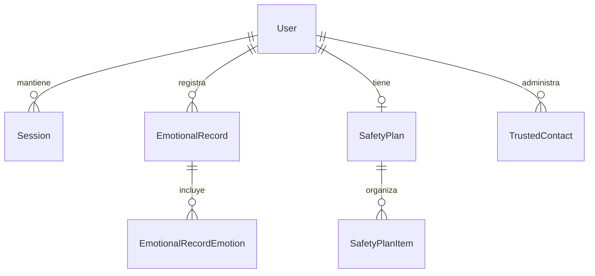

# Backend CONTIGO

## Modelo relacional

PostgreSQL almacena identificadores UUID y Prisma administra las consultas y migraciones versionadas.



| Tabla | Datos principales | Relaciones y reglas |
|---|---|---|
| `users` | Nombre, apellido opcional, correo único y hash de contraseña Argon2id; fechas de creación y actualización. | Un usuario tiene sesiones, registros emocionales, a lo más un plan y varios contactos. |
| `sessions` | Hash SHA-256 de las credenciales opacas de acceso y renovación; cliente, expiraciones, revocación y última actividad. | Cada sesión pertenece a un usuario. Los hashes de acceso y renovación son únicos; las filas heredadas sin renovación quedan revocadas por la migración. |
| `emotional_records` | Estado de ánimo, nota y detalle opcionales, fechas del registro y creación. | Cada registro pertenece a un usuario. La consulta siempre filtra por el propietario autenticado. |
| `emotional_record_emotions` | Emoción seleccionada por registro. | Clave primaria compuesta por registro y emoción; elimina asociaciones si se elimina el registro. |
| `safety_plans` | Fechas de creación y actualización. | Relación uno a uno con usuario mediante `user_id` único. |
| `safety_plan_items` | Tipo (`WARNING_SIGN`, `COPING_ACTION`, `SAFE_PLACE`), contenido y posición. | Cada elemento pertenece a un plan; se conserva el orden por tipo y posición. |
| `trusted_contacts` | Nombre, teléfono textual, relación/detalles opcionales y fechas. | Cada contacto pertenece a un usuario y no se duplica como texto dentro del plan. |

Las relaciones de sesiones, registros, planes y contactos hacia `users` usan `ON DELETE RESTRICT`: eliminar un usuario no borra automáticamente sus datos personales. Las filas dependientes de un registro emocional o de un plan sí se eliminan junto con su entidad propietaria. Los índices cubren correo, hashes de sesión, propietario/fecha de consulta y posición de elementos.

## Autenticación y sesiones

- Las contraseñas se guardan como Argon2id con parámetros configurados en `backend/src/services/auth.service.ts`; nunca se incluyen en respuestas.
- Registro y sesión inicial se crean en una transacción. Si una dirección de correo ya existe, la API responde `409 EMAIL_ALREADY_REGISTERED`.
- El servidor genera credenciales opacas aleatorias. PostgreSQL conserva solo su hash SHA-256; no se registran credenciales ni cuerpos de solicitudes.
- La credencial de acceso dura los minutos definidos por `ACCESS_TOKEN_TTL_MINUTES` (15 por defecto). La credencial de renovación dura los días definidos por `SESSION_TTL_DAYS` (14 por defecto) y rota en cada renovación mediante una actualización condicional.
- Las credenciales expiradas, revocadas, ya rotadas o de otro tipo de cliente no autorizan la renovación. El cierre de sesión revoca la sesión.
- Navegador: usa cookies `contigo_access` y `contigo_refresh` con `HttpOnly`, `SameSite` configurable y `Secure` obligatorio en producción. Las mutaciones requieren cookie y encabezado CSRF coincidentes (`XSRF-TOKEN` y `X-XSRF-TOKEN`).
- Capacitor nativo: recibe las credenciales en JSON y debe guardarlas exclusivamente en Keychain/Keystore. El plugin de almacenamiento seguro no debe inicializarse en web, donde su fallback podría usar `localStorage`.
- El propietario de cada dato se deriva de la sesión autenticada. Nunca se acepta el usuario propietario desde el cuerpo de una solicitud.

## Rutas de autenticación

| Método | Ruta | Uso |
|---|---|---|
| `GET` | `/api/auth/csrf` | Obtener la prueba CSRF para el navegador. |
| `POST` | `/api/auth/register` | Crear cuenta y sesión inicial. |
| `POST` | `/api/auth/login` | Iniciar sesión. |
| `POST` | `/api/auth/refresh` | Rotar las credenciales de una sesión vigente. |
| `GET` | `/api/auth/me` | Consultar el perfil autenticado. |
| `PATCH` | `/api/auth/me` | Actualizar nombre, apellido o correo propios. |
| `POST` | `/api/auth/logout` | Revocar la sesión actual. |

Las rutas de registro, inicio y renovación tienen límite de frecuencia. En web, los tokens no aparecen en los cuerpos de respuesta; en cliente nativo, el transporte los devuelve para que el adaptador seguro del dispositivo los persista.

La referencia completa de endpoints, validación, transporte, ejemplos y errores está en [API.md](./API.md).

## Migraciones

`backend/prisma/schema.prisma` es el modelo fuente. Las migraciones en `backend/prisma/migrations/` son versionadas y deben desplegarse con `npm run prisma:migrate:deploy`; no reemplazar su historial con `prisma db push`. La migración de rotación de credenciales invalida las sesiones anteriores, por lo que las personas deberán volver a iniciar sesión tras su despliegue.

## Ejecución y operación

La ejecución recomendada es desde la raíz del repositorio con Docker Compose. Copia `.env.example` a `.env`, reemplaza el secreto de PostgreSQL y asegúrate de que `DATABASE_URL` use el hostname `database` y las mismas credenciales que `POSTGRES_USER`, `POSTGRES_PASSWORD` y `POSTGRES_DB`. Después ejecuta:

```powershell
docker compose up -d --build
docker compose ps
docker compose logs -f backend database migrate
```

El servicio `migrate` aplica `prisma migrate deploy` después del healthcheck de PostgreSQL y antes de iniciar la API. Nginx reenvía `/api/` al backend en el puerto interno 3000; ese puerto y PostgreSQL no se publican en el host. Consulta el [README raíz](../README.md) para ejecutar la app web/móvil y crear o restaurar respaldos sin borrar el volumen de datos.

Para desarrollar la API fuera de Docker, copia `backend/.env.example` a `backend/.env`, configura `DATABASE_URL` para un PostgreSQL accesible desde el host (por ejemplo, con hostname `localhost`), instala dependencias y aplica migraciones:

```powershell
Set-Location backend
npm.cmd ci
npm.cmd run prisma:generate
npm.cmd run prisma:migrate:deploy
npm.cmd run dev
```

El backend valida `NODE_ENV`, `DATABASE_URL`, TTL de credenciales, cookies, orígenes permitidos, proxy y nivel de logs al iniciar. En producción `COOKIE_SECURE=true` es obligatorio; publica el servicio solo detrás de HTTPS y conserva los secretos en variables de entorno, nunca en el repositorio. `GET /api/health` comprueba el proceso y `GET /api/ready` comprueba también PostgreSQL.
